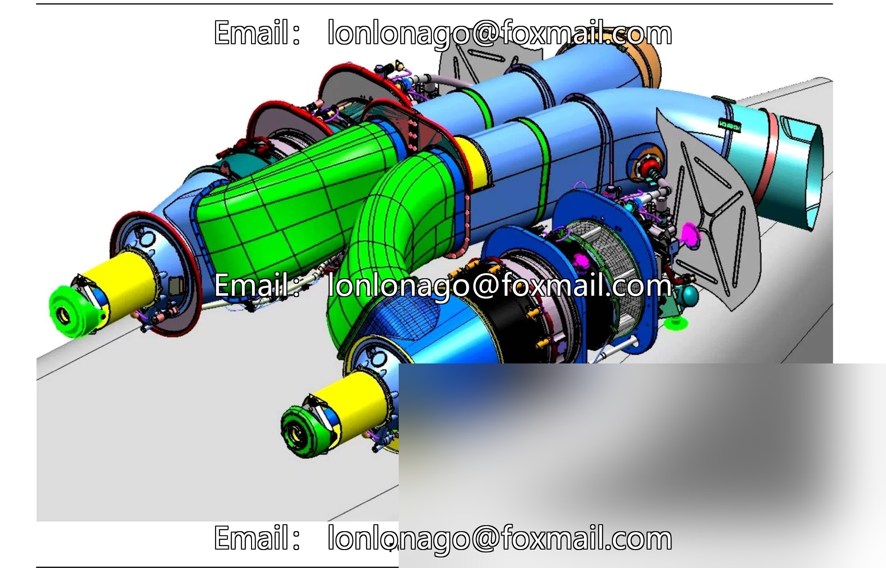
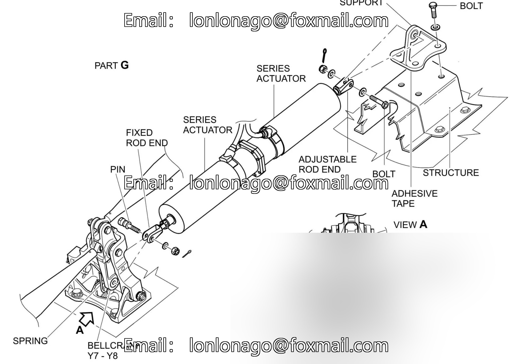
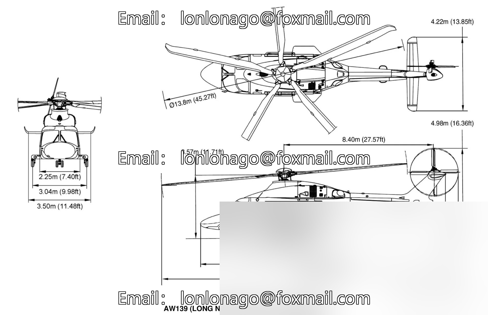
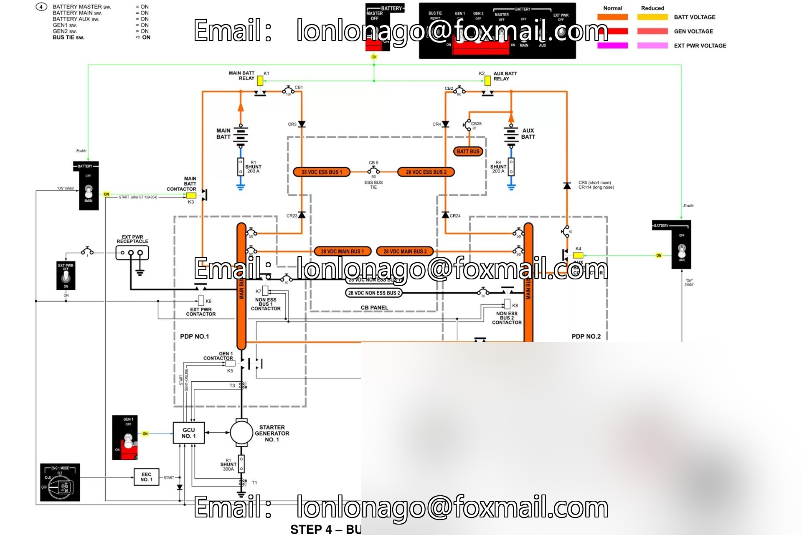
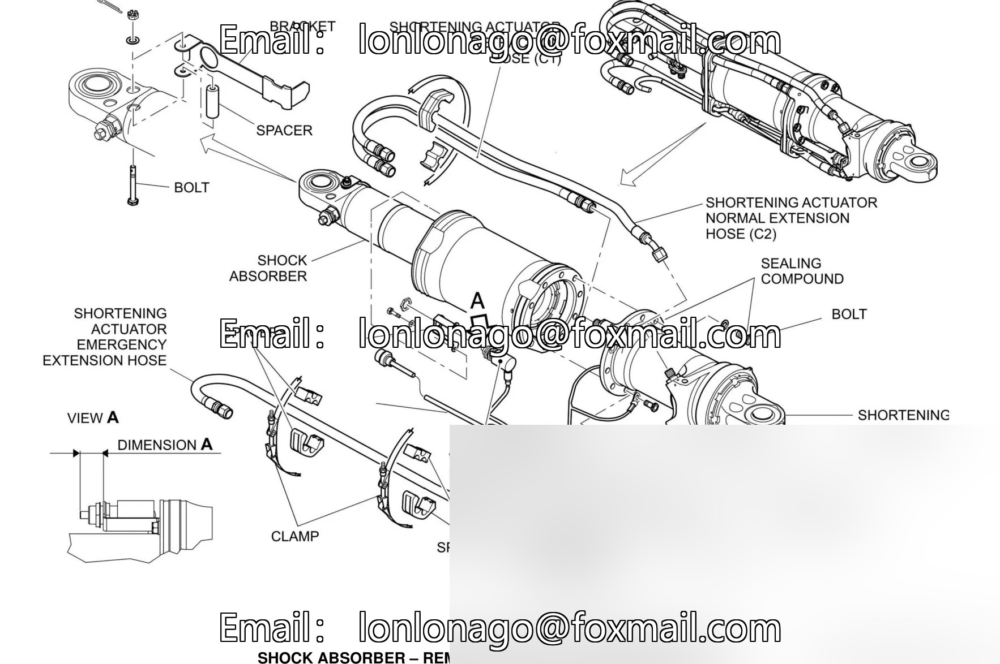
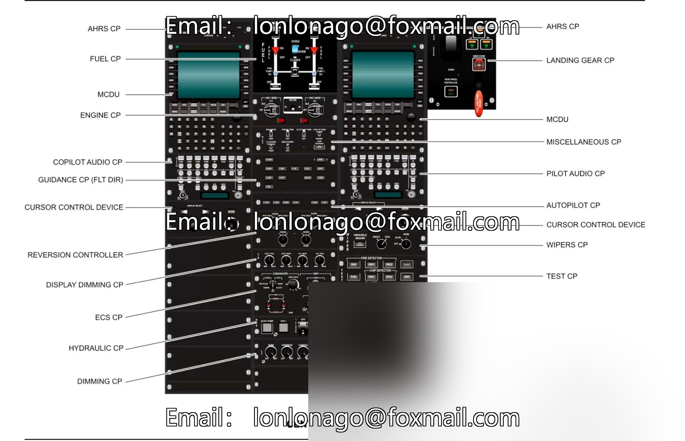

# AW139 helicopter body maintenance training manual

## Body

Aero-Helicopter Airframe Maintenance Training Manual
PDF , 2,200 pages, covering training courses for B1.3-class maintenance personnel, suitable for personnel who can obtain or hold a turbine helicopter mechanical maintenance license (EASA Part-66 standard), systematically explaining relevant knowledge about the airframe maintenance of Aero-Helicopter.
non-refundable after sale.

This is the AW139 helicopter body maintenance training material, covering B1.3-type training, related repair knowledge and dimension information.

<!-- AI_ENRICHED -->

## Images

## Payment

Here is a pay link on Stripe ( https://buy.stripe.com/3cs8yP7sY87d0vu9AB ). Please contact me lonlonago@foxmail.com after funding $89, and I will send you a complete data files , thank you!

